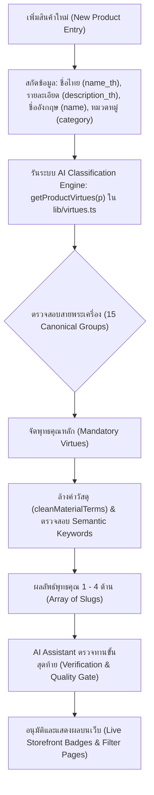

# DAN SIAM AMULETS: MASTER MULTI-VIRTUE TAXONOMY & CLASSIFICATION RULES
**คู่มือมาตรฐานและหลักเกณฑ์การจำแนกพุทธคุณพระเครื่องสากลนิยม (Dan Siam Amulets Master Doctrine)**  
*เวอร์ชัน 1.0 — บันทึก ณ วันที่ 18 ตุลาคม 2026*

---

## 1. บทนำและปรัชญาความเชื่อมั่น (Executive Summary & Philosophy)

ระบบจัดหมวดหมู่พุทธคุณของ **Dan Siam Amulets** ถูกออกแบบขึ้นตามหลักวิชาการพระเครื่องไทยและจารีตพุทธาภิเษกสากลนิยม เพื่อส่งมอบข้อมูลที่ถูกต้อง แม่นยำ และสร้างความเชื่อมั่นสูงสุด (Trust & Authority) ให้แก่ผู้ศรัทธาและนักสะสมทั้งชาวไทย ชาวจีน สิงคโปร์ มาเลเซีย และนานาชาติ

### กฎทองคำ 3 ประการ:
1. **พระ 1 องค์ มีพุทธคุณหลายด้าน (Multi-Virtue Doctrine):** พระเครื่องและวัตถุมงคลแต่ละองค์ได้รับการอธิษฐานจิตและมีพุทธานุภาพมากกว่า 1 ด้านเสมอ (เฉลี่ย 2–4 ด้าน) เช่น พระปิดตาปลดหนี้มีทั้ง "โชคลาภค้าขาย" และ "แคล้วคลาดนิรันตราย" หรือ พระสมเด็จมีพุทธคุณครอบจักรวาลทั้ง "อำนาจบารมี เมตตา แคล้วคลาด"
2. **วัสดุและรูปทรงไม่ใช่พุทธคุณ (Form Factor & Material Disambiguation):** คำว่า "เหรียญ", "พระผง", "เนื้อเงิน", "เนื้อทองแดง", "กะไหล่ทอง", "เลี่ยมทอง" เป็นเพียงสสารและรูปทรงภายนอก ห้ามนำมาจับเป็นหมวดพุทธคุณโชคลาภหรือด้านอื่นๆ อย่างเด็ดขาด
3. **ยึดถือพระเวทวิทยาคมและเจตนาการสร้างจริง (Sacred Iconography & Lineage):** การจัดพุทธคุณต้องอิงจากพิมพ์ทรง (Iconography), สายวิชาของพระเกจิผู้ปลุกเสก (Consecration Lineage), ยันต์ประทับ และชื่อรุ่นมงคลเป็นหลัก

---

## 2. เสาหลักพุทธคุณ 4 ด้าน (The 4 Canonical Core Virtues)

ระบบหน้าเว็บและฐานข้อมูลจัดแบ่ง Landing Page และ Filter พุทธคุณออกเป็น 4 หมวดหลัก:

| รหัส Slug | ภาษาไทย (TH) | ภาษาอังกฤษ (EN) | ภาษาจีน (ZH) | สัญลักษณ์ Badge |
|---|---|---|---|---|
| `wealth-and-fortune` | **พระเสริมโชคลาภ การเงิน ค้าขาย** | Wealth, Fortune & Business Prosperity | 泰国招财、偏财与经商致富佛牌 | 💰 มหาลาภ · ค้าขายร่ำรวย · ปลดหนี้ (招财 / 偏财) |
| `miraculous-protection` | **พระแคล้วคลาด ปลอดภัย กันภัย** | Miraculous Protection & Accident Safety | 泰国避险保平安、护身辟邪佛牌 | 🛡️ นิรันตราย · แคล้วคลาด · คุ้มครองภัย (避险 / 保平安) |
| `metta-and-charisma` | **พระเมตตามหานิยม มหาเสน่ห์ เจรจา** | Metta, Loving-Kindness & Charisma | 泰国人缘贵人、增进魅力与谈判商机佛牌 | 💖 เมตตามหานิยม · เสน่ห์เจรจา · ผู้ใหญ่เอ็นดู (人缘 / 贵人) |
| `career-and-power` | **พระเสริมอำนาจบารมี การงาน เลื่อนตำแหน่ง** | Career Success, Leadership Aura & Authority | 泰国事业升迁、领导威严与破除阻碍佛牌 | 👑 มหาอำนาจ · บารมีผู้นำ · เลื่อนขั้นตำแหน่ง (事业 / 升迁) |

---

## 3. ตารางแม่บท 15 สายพระเครื่องและการจัดพุทธคุณ (15 Canonical Groups Matrix)

| กลุ่มที่ | สายพระเครื่อง / วัตถุมงคล | ตัวอย่างสำคัญในแค็ตตาล็อก | พุทธคุณหลักที่ต้องได้รับ (Mandatory Virtues) | เงื่อนไขเพิ่มเติม (Conditional Virtues) |
|---|---|---|---|---|
| **1** | **พระสมเด็จ (ราชาแห่งพระเครื่อง)** | วัดระฆัง, บางขุนพรหม, เกศไชโย, สมเด็จ 100 ปี, สมเด็จเกจิ | 👑 อำนาจบารมี (`career-and-power`)<br>🛡️ แคล้วคลาด (`miraculous-protection`)<br>💖 เมตตามหานิยม (`metta-and-charisma`) | ได้ 💰 โชคลาภ (`wealth-and-fortune`) เมื่อชื่อรุ่นระบุเจาะจง เช่น รุ่นมหาลาภ, เงินล้าน, เศรษฐี, ปลดหนี้ |
| **2** | **หลวงพ่อทวด (นิรันตรายอันดับ 1)** | วัดช้างให้, วัดทรายขาว, วัดห้วยมงคล, วัดพะโคะ | 🛡️ แคล้วคลาดปลอดภัย (`miraculous-protection`)<br>💖 เมตตามหานิยม (`metta-and-charisma`) | ได้ 💰 โชคลาภ เมื่อเป็นรุ่นเสริมโชค เช่น สิทธิโชค, อนันตทรัพย์, มหาเศรษฐี |
| **3** | **พระปิดตา (พระภควัมบดี)** | หลวงปู่โต๊ะ (จัมโบ้/ปลดหนี้), หลวงพ่อแก้ว, ปิดตาพังพะกาฬ, ปิดตาวัดหนัง | 💰 โชคลาภการเงิน (`wealth-and-fortune`)<br>🛡️ แคล้วคลาดมหาอุด (`miraculous-protection`) | ได้ 💖 เมตตา เมื่อมีมวลสารจินดามณี/เกสร<br>ได้ 👑 อำนาจ เมื่อเป็นพิมพ์ยันต์ยุ่ง/หัวจรวด/แร่บางไผ่ |
| **4** | **พระขุนแผน** | ขุนแผนบ้านกร่าง, หลวงปู่ทิม วัดละหารไร่, หลวงพ่อกวย, หลวงพ่อสาคร | 💖 เมตตามหาเสน่ห์ (`metta-and-charisma`)<br>💰 โชคลาภการเงิน (`wealth-and-fortune`) | ได้ 🛡️ แคล้วคลาด เมื่อเป็นสายพรายกุมาร/กุมารทอง<br>ได้ 👑 อำนาจ เมื่อเป็นพิมพ์ทรงพล, ยอดขุนพล, ปราบมาร |
| **5** | **พระนางพญา (ราชินีแห่งพระเครื่อง)** | พระนางพญาพิษณุโลก, นางพญาวัดประสาท, นางพญาเกจิ | 💖 เมตตามหานิยม (`metta-and-charisma`)<br>👑 อำนาจบารมีผู้นำ (`career-and-power`)<br>🛡️ แคล้วคลาด (`miraculous-protection`) | ครบทั้ง 3 ด้านเสมอ (เอกลักษณ์ความสง่างามและบารมี) |
| **6** | **พระรอด & พระคง & พระบาง** | กรุวัดมหาวัน, กรุวัดพระคง, พระรอดเกจิ | 🛡️ แคล้วคลาดรอดพ้นภัย (`miraculous-protection`)<br>👑 มหาอำนาจ ชนะศึก (`career-and-power`) | — |
| **7** | **พระกริ่ง & พระชัยวัฒน์** | วัดสุทัศน์, พระกริ่งปวเรศ, พระกริ่งชินบัญชร | 🛡️ สุขภาพ ปลอดภัย กันภัย (`miraculous-protection`)<br>👑 มหาอำนาจ ชัยชนะ (`career-and-power`) | ได้ 💰 โชคลาภ เมื่อเป็นรุ่นมหาลาภ, โภคทรัพย์, เศรษฐี |
| **8** | **พระนาคปรก** | นาคปรกใบมะขาม, นาคปรกโบราณ | 👑 คุ้มชะตา มหาอำนาจ (`career-and-power`)<br>🛡️ แคล้วคลาด กันภัย (`miraculous-protection`) | พระประจำวันเสาร์ ป้องกันภัยรอบทิศ |
| **9** | **พระสาวกและเกจิสายโชคลาภเฉพาะทาง** | พระสังกัจจายน์, พระสิวลี, พระอุปคุต, เหรียญเจ้าสัว, หลวงพ่อเงิน, หลวงพ่อรวย, เศรษฐีนวโกฏิ | 💰 โชคลาภการเงิน ค้าขาย (`wealth-and-fortune`)<br>💖 เมตตามหานิยม (`metta-and-charisma`) | พระอุปคุต ได้ 🛡️ แคล้วคลาดกันภัย/ปราบมาร เพิ่มด้วย |
| **10** | **มหาเทพและเทวรูปศักดิ์สิทธิ์** | - ท้าวเวสสุวรรณ<br>- พญาครุฑ<br>- พระพิฆเนศ<br>- พระพรหม 4 หน้า<br>- พระราหู | • ท้าวเวสสุวรรณ: 💰 + 👑 + 🛡️<br>• พญาครุฑ: 👑 + 🛡️<br>• พระพิฆเนศ: 👑 + 💰 + 💖<br>• พระพรหม: 👑 + 💖 + 💰 + 🛡️ (ครบ 4 ด้าน)<br>• พระราหู: 🛡️ + 💰 (แก้ชง + เสี่ยงโชค) | ทรงพลังตามคัมภีร์เทวศาสตร์ |
| **11** | **เครื่องรางสายป้องกันภัยและมหาปราบ** | ตะกรุด, เบี้ยแก้, มีดหมอ, เสือ, สิงห์, หนุมาน, มเหศวร, ท่ากระดาน, ปรุหนัง, ยอดธง | 🛡️ แคล้วคลาด คงกระพัน กันภัย (`miraculous-protection`) | ได้ 👑 อำนาจ เมื่อเป็น เสือ, สิงห์, หนุมาน, ยอดธง<br>ได้ 💰 โชคลาภ เมื่อเป็นตะกรุดโภคทรัพย์, สาริกา |
| **12** | **เครื่องรางสายเมตตามหาลาภ** | นางกวัก, กุมารทอง, สาริกา, สีผึ้ง, ผานไถ, น้ำเต้าดูดทรัพย์, ชูชก, พญาเต่าเรือน, ถุงเหนี่ยวทรัพย์ | 💰 โชคลาภการเงิน (`wealth-and-fortune`)<br>💖 เมตตามหานิยม (`metta-and-charisma`) | ผานไถ ได้ 👑 พลิกฟื้นชะตา/การงาน<br>จินดามณี ได้ 🛡️ คุ้มครองรักษากาย |
| **13** | **พระพุทธปฏิมาสำคัญและพระกรุยอดนิยม** | หลวงพ่อโสธร, พระพุทธชินราช, หลวงพ่อโต, พระแก้วมรกต, พระลีลา, พระซุ้มกอ, พระผงสุพรรณ | 🛡️ แคล้วคลาด ปลอดภัย (`miraculous-protection`)<br>👑 มหาอำนาจบารมี (`career-and-power`) | หลวงพ่อโสธร/ปากน้ำ/ซุ้มกอ ได้ 💰 โชคลาภ<br>พระลีลา/ชินราช ได้ 💖 เมตตามหานิยม |
| **14** | **พระเกจิคณาจารย์ผู้ทรงบารมี** | หลวงพ่อคูณ, หลวงปู่หมุน, หลวงพ่อกวย, หลวงปู่ทิม, หลวงปู่โต๊ะ, หลวงพ่อเปิ่น, หลวงพ่อสด, หลวงปู่หลิว, คุณแม่บุญเรือน | 🛡️ แคล้วคลาด ปลอดภัย (`miraculous-protection`)<br>💖 เมตตามหานิยม (`metta-and-charisma`) | ได้ 💰 โชคลาภ หากเป็นสายมหาลาภ (คูณ, กวย, หลิว, บุญเรือน, รวย)<br>ได้ 👑 บารมี หากเป็นพิมพ์เลื่อนสมณศักดิ์, เจริญพร, มหาอำนาจ |
| **15** | **พ่อแก่ พระฤาษี บรมครู** | เศียรพ่อแก่, ฤาษีเบิกไพร, ฤาษีตาไฟ | 👑 อำนาจบารมี ครูบาอาจารย์ (`career-and-power`)<br>💖 เมตตา มหานิยม เสน่ห์ศิลปิน (`metta-and-charisma`)<br>🛡️ แคล้วคลาด ป้องกันคุณไสย (`miraculous-protection`) | สำหรับศิลปิน ดารานักแสดง และผู้บริหาร |

---

## 4. กฎเหล็กตัวกรองคำขยะและการแก้ความกำกวม (Stopwords & Disambiguation Rules)

เพื่อให้ระบบ Filter แม่นยำ 100% ปราศจาก False Positives โค้ดใน `dansiamamulet/lib/virtues.ts` และเจ้าหน้าที่ตรวจรับสินค้าต้องปฏิบัติตามกฎนี้อย่างเคร่งครัด:

```typescript
// กฎการล้างคำวัสดุก่อนตรวจคำว่า "โชคลาภ/เงินทอง"
function cleanMaterialTerms(text: string): string {
  return text
    .replace(/เนื้อทองแดงรมดำ/g, '')
    .replace(/เนื้อทองแดงผิวไฟ/g, '')
    .replace(/เนื้อทองแดง/g, '')
    .replace(/เนื้อทองเหลือง/g, '')
    .replace(/เนื้อโลหะกะหลั่ยทอง/g, '')
    .replace(/เนื้อโลหะกะไหล่ทอง/g, '')
    .replace(/กะไหล่ทอง/g, '')
    .replace(/กะหลั่ยทอง/g, '')
    .replace(/ชุบทอง/g, '')
    .replace(/ปิดทอง/g, '')
    .replace(/เลี่ยมทอง/g, '')
    .replace(/ทองทิพย์/g, '')
    .replace(/ทองฝาบาตร/g, '')
    .replace(/ทองคำ/g, '')
    .replace(/เนื้อเงิน/g, '')
    .replace(/กะไหล่เงิน/g, '')
    .replace(/กะหลั่ยเงิน/g, '')
    .replace(/ลงยาเงิน/g, '')
    .replace(/แผ่นเงิน/g, '')
    .replace(/เลี่ยมเงิน/g, '')
    .replace(/เงิน๙๒/g, '');
}
```

### รายการคำต้องห้ามที่ไม่ให้ใช้จัดพุทธคุณเดี่ยวๆ:
1. **ห้ามจับคู่คำว่า "เงิน" โดดๆ:**
   - ❌ ห้าม: `เนื้อเงิน`, `เลี่ยมเงิน`, `แผ่นเงินตอกโค้ด` -> ไม่ใช่โชคลาภ
   -  อนุญาต: `หลวงพ่อเงิน`, `เงินทอง`, `เงินล้าน`, `ปลดหนี้`, `ทวีทรัพย์`
2. **ห้ามจับคู่คำว่า "ทอง" โดดๆ:**
   - ❌ ห้าม: `เนื้อทองแดง`, `กะไหล่ทอง`, `เลี่ยมทอง`, `ทองฝาบาตร` -> ไม่ใช่โชคลาภ
   -  อนุญาต: `นะหน้าทอง`, `สาริกาลิ้นทอง`, `มั่งมีศรีสุข`, `ทองคำมหาลาภ`
3. **คำว่า "คอน้ำเต้า" (Medal Shape Disambiguation):**
   - ❌ ห้าม: `เหรียญทรงคอน้ำเต้า`, `เหรียญคอน้ำเต้า` เป็นแค่รูปทรงเหรียญพระเกจิ ไม่ใช่ "เครื่องรางน้ำเต้าดูดทรัพย์"
   -  อนุญาต: `น้ำเต้าดูดทรัพย์`, `น้ำเต้ากันภัย` จัดเป็นเครื่องรางมหาลาภ
4. **ตัดข้อความ Boilerplate ภาษาอังกฤษ:**
   - ❌ ห้าม: ข้อความตายตัวท้าย Description เช่น `"... protection & prosperity blessing. Certified genuine ..."` ที่ติดมากับสินค้าเกือบทุกรายการ ห้ามนำมาจับเป็น Protection หรือ Wealth เด็ดขาด

---

## 5. ขั้นตอนปฏิบัติมาตรฐานเมื่อเพิ่มสินค้าใหม่ (New Product Ingestion SOP)

เมื่อมีการเพิ่มสินค้าใหม่ลงในระบบ Dan Siam Amulets (ไม่ว่าจะผ่านทาง Admin Panel, Supabase Database, หรือสคริปต์ Import):



### บทบาทของ AI Assistant ในอนาคต:
1. **ตรวจทานอัตโนมัติ (Automated Guardian):** ทุกครั้งที่คุณเพิ่มสินค้าใหม่ AI Assistant จะนำชื่อพระและประวัติมาวิเคราะห์ตามเกณฑ์ 15 กลุ่มนี้ทันที
2. **รายงานพุทธคุณให้ทราบล่วงหน้า:** ระบบจะแจ้งให้คุณทราบว่า พระองค์นี้ได้รับ Badge อะไรบ้าง เช่น:
   > **ตัวอย่าง:** *พระปิดตาเงินล้าน หลวงปู่โต๊ะ วัดประดู่ฉิมพลี*  
   > -> ได้รับพุทธคุณ: `[wealth-and-fortune, miraculous-protection, metta-and-charisma]`
3. **ป้องกันข้อผิดพลาด 100%:** มั่นใจได้ว่าพระยอดขุนพล หรือเหรียญหลวงพ่อทวดเนื้อทองแดง จะไม่หลุดไปโผล่ในหมวดค้าขายโดยไม่ตั้งใจเด็ดขาด

---
*เอกสารฉบับนี้เป็นกรรมสิทธิ์ของ Dan Siam Amulets ใช้เป็นเกณฑ์มาตรฐานหลักของระบบตลอดไป*
